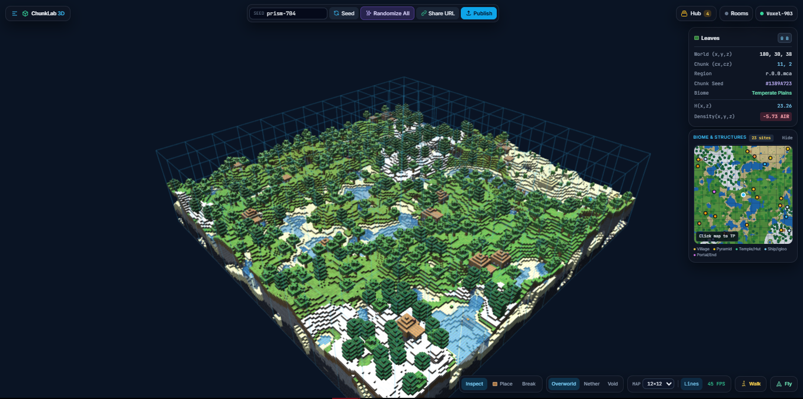

# ChunkLab 3D — Studio Edition

An interactive 3D procedural voxel terrain studio and real-time multiplayer sandbox built with Three.js and Firebase—packaged entirely inside a single HTML file with zero build steps.

**[Launch Live Studio →](https://kiyolog010.github.io/chunklab-3d/)**

## Features

* **Real-Time Procedural Math Engine:** Tune multi-octave 2D Perlin noise, interactive continentalness splines, erosion, ridge sharpness, temperature/humidity shifts, 3D density overhangs, and Swiss-cheese cave carvers live[cite: 8].
* **3 Dimensions & Up to 16×16 Chunks:** Switch seamlessly between **Overworld**, **Nether** (ceiling + lava oceans), and **Void Islands** across map sizes from `1×1` up to `16×16` (`256 × 256` blocks)[cite: 8].
* **Live Multiplayer Rooms & Community Hub:** Create a 5-letter room code to sculpt together in real time with 3D builder avatars, incremental chunk syncing, and a public Community Seed Hub[cite: 8].
* **Sculpting, Minimap & First-Person Modes:** Paint or carve with `1×1` to `5×5` brushes (plus Undo/Redo), click structure pins on the 2D biome minimap to teleport, or drop into **Walk** and **Fly** modes[cite: 8].
* **Direct Exports:** Export any generated or sculpted terrain to **Blender (`.glb`)** or **Minecraft Java Edition (`.mcfunction`)**[cite: 8].
